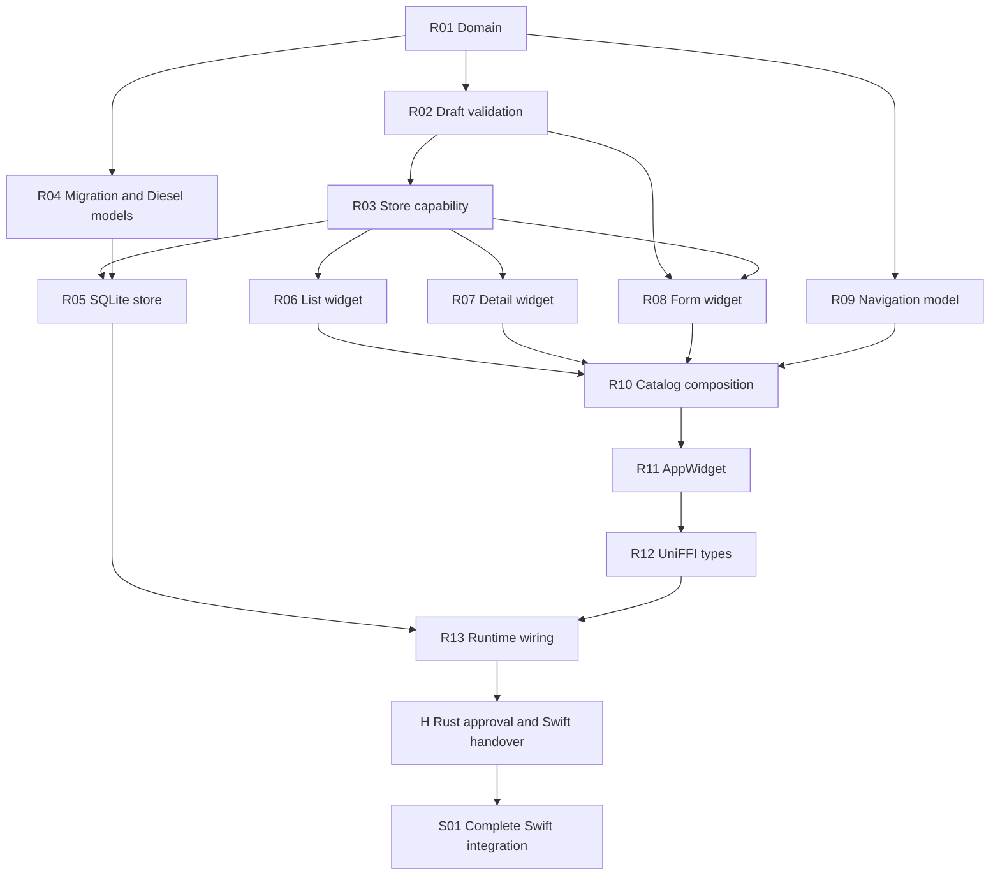

# Ingredient catalog epic

Status: architecture and task graph approved. R01 (`tskssmvt`) is approved.
R02 (`pwkoosll`) is awaiting review; its
[implementation plan](ingredient-catalog/tasks/R02-drafts.md) is part of that
change. Later tasks remain planned.

## Goal and scope

Build the first useful part of the cooking helper: a persistent catalog of generic
ingredients, with list, detail, and create/edit screens. The floating + button
opens a separate form. Native bottom tabs expose Ingredients and the existing
Counter. Rust owns both tab selection and ingredient navigation.

An `Ingredient` means a generic food such as garlic, cucumber, or canned tomatoes.
A future branded `Product` can refer to it. This epic does not implement products,
barcodes, stores, baskets, shopping lists, recipes, meal planning, pantry inventory,
expiry tracking, or device synchronization. Reference weights are ingredient data,
not stock quantities. UUID identity prepares for future sharing without introducing
a sync protocol now.

Proposed first catalog fields, carried forward from the prototype:

- Required name and optional notes.
- Optional calories, protein, carbohydrates, and fat per 100 g or 100 ml.
- Optional named reference units, such as a clove or a can, with an approximate
  weight and/or volume. A reference unit needs a name and a positive measurement.
- Empty nutrition values mean unknown; zero is a known value. Changing the basis
  changes the interpretation of manually entered values, without doing conversions.

These field and interaction choices are part of this plan's review. Search and
sorting use a shared trimmed, Unicode case-folded name key. Ingredient names are
unique within the catalog; reference-unit names are unique within an ingredient.
The store enforces uniqueness, including races. The form does not cache the whole
catalog to duplicate that check.

## Starting point and reference work

The current baseline has the counter widget, a composition example, Diesel/SQLite
counter persistence, UniFFI integration, and Swift counter tests. It has no
ingredient feature or committed ingredient snapshot harness.

The unfinished `jj` change `lvqurwlm` (observed at `b24378f7`, with a conflict)
contains the earlier implementation. It is reference material only. Its useful
lessons inform the decisions below; its code and tests must be assessed task by
task. This plan does not merge or repair that branch or restore it wholesale.

## Architecture

### Domain and persistence

`crates/kreatyna` owns ingredient identity, exact measurements, drafts, validation,
and store contracts. Use an `IngredientId` newtype around `uuid::Uuid` with v4
generation and `rust_decimal::Decimal` for measurements and nutrition. Creation
and update are explicit operations; no numeric zero or nil UUID sentinel denotes
a new item. Widget collection indices use `usize`.

Validation identifies fields and reasons through enums, including indices for
repeated unit fields. Load, save, and delete failures are typed. Swift supplies
the displayed text so Rust has no dependency on a UI language. The task-level
plans will settle constructors and parsing details, including decimal range and
precision rejection rather than silent loss.

An ingredient capability in `ingredients/capabilities.rs` exposes persistence to
widgets. Its request/response envelopes and test driver follow the existing
krucyfiks pattern. Widgets depend on that contract, not on Diesel or a live DB.

`crates/kreatyna-ffi/src/database` implements the capability. SQLite retains a
private auto-increment `local_id` and a unique UUID `remote_id`; public identities
are UUIDs. Diesel models use newtypes for identifiers and appropriate typed
representations for basis and decimal fields. Decimal storage and transport must
round-trip exactly; SQLite text storage is the proposed representation.

Parent and reference-unit writes are transactional. Missing updates must not
silently create rows. Deletion cascades to units. Introduce one ingredient
migration on top of the current counter schema; this pre-alpha epic does not need
an upgrade migration from the discarded ingredient prototype. Preserve the
existing counter database and its data.

### Widgets and composition

| Component | Owns | Collaborates through |
| --- | --- | --- |
| Ingredient list widget | Loaded catalog, search, ordering, loading/retry state | Store results; selection/create intents for its parent |
| Ingredient detail widget | Displayed ingredient, delete confirmation and pending/error state | Edit intent and delete completion for its parent |
| Ingredient form widget | Create/edit draft, validation issues, dirty/discard state, pending save | Typed store errors, save/discard completion for its parent |
| Ingredient catalog coordinator | Active child lifetime and navigation; updating list/detail after a write | Composed child events, outcomes, and views |
| AppWidget | Ingredients and Counter children, selected tab | Composed child events, outcomes, and effects |

Each widget gets its own event, outcome, and view types. Parent enums wrap child
types instead of copying every variant into a flat parent enum. Compose view data
around active screen variants rather than a route plus unrelated optional fields
that can disagree. Keep the catalog coordinator focused on composition, not field
validation, parsing, or SQL.

The composition example in `crates/kreatyna/src/composability.rs` is the starting
pattern. Render pending/loading state before starting the associated store call
when order matters. Use sequential commands for this; concurrent command
composition is reserved for independent work such as initializing both app tabs.

### Navigation as a separate concept

The list is always the root. Valid screen histories are:

- List alone.
- List → form for creation or direct editing.
- List → detail.
- List → detail → edit form for that same ingredient.

Use a finite typed navigation model, with edit origin encoded. It cannot represent
arbitrary stacks, two detail screens, or editing one ingredient under another's
detail. Opening a different ingredient replaces the current detail. Back and
discard refer to meaningful destinations rather than arbitrary numeric depths.

The navigation task defines these rules independently of widget internals. The
coordinator then uses that approved model to hold the relevant child widgets and
derive its view; it must not keep a second independently mutable route alongside
optional detail/form state. The task plans will choose the concrete types once
the child contracts are reviewed.

Proposed behavior: row tap opens detail, + opens creation, detail requests editing,
and a list edit action can open the form directly. Successful editing returns to
its origin; creation and deletion return to the list. Failed saves preserve the
draft; dirty Back asks before discarding. Pending writes and confirmations guard
incompatible actions. Delayed child outcomes must not navigate a replacement
screen. Tab changes retain ingredient state. Counter appearance and behavior stay
consistent, including stopping its background activity when leaving that tab.

### Rust/Swift boundary

UniFFI exposes typed composed events and views plus the Rust app runtime. UUIDs
and decimals cross through lossless representations with checked conversions;
Rust-owned `usize` indices get explicit fixed-width bridge conversions. Keep the
counter bridge usable until the app adapter replaces its production use.

Swift observes view updates on the main actor, renders native tabs and navigation,
and forwards events. It may project the typed Rust route into a SwiftUI navigation
path; it does not own another business navigation state machine. Keyboard focus,
animation, and temporary text presentation may remain in Swift. Validation,
uniqueness, route decisions, and SQLite access remain in Rust.

Runtime wiring owns the lifetimes of the core and database workers. Startup
failure and retry must reach the UI through typed state rather than losing a
worker silently. Review Rust and its bridge before starting Swift. Swift work
begins once the user approves the completed Rust side; that approval is the
handover requested by `AGENTS.md`. Approval of this plan alone is not that
handover.

## Task DAG and review boundaries

Every row below is a separate implementation task and `jj` change, including its
relevant tests. Dependencies mean the preceding contracts must be approved. They
do not mean all nodes on one layer will be implemented before pausing for review.
R01 is **approved**; R02 is **awaiting review**. Later tasks are **planned**; their
detailed plans are deferred until their dependencies are approved.

### Rust tasks

| ID | Review surface and outcome | Direct dependencies | Acceptance evidence |
| --- | --- | --- | --- |
| R01 | Ingredient domain: identity, measurements, nutrition basis, reference units, name normalization. Core types and Cargo dependencies only. | — | UUID v4 identity; exact decimal round trips; shared name-key semantics. No drafts, SQL, widgets, or bridge. |
| R02 | Draft parsing and typed validation: editable text becomes valid ingredient write data. | R01 | Unknown versus zero, decimal limits, positive unit measurements, named fields/issues, create/edit identity semantics. No effects or screens. |
| R03 | Ingredient store capability: typed operations, errors, effect envelopes, and test fixture in a separate module. | R02 | Requests/responses and transport errors round-trip through the capability driver. No database implementation. |
| R04 | Ingredient migration and Diesel models: local/remote IDs, exact decimal mapping, units, and constraints. | R01 | Empty and existing counter DB migration; typed SQL value round trips; foreign keys and uniqueness. No widget behavior or CRUD service. |
| R05 | SQLite ingredient store implementation and transactions. | R03, R04 | CRUD, UUID stability, duplicate-name error, missing update, rollback, cascade, and reopen persistence. Counter data survives. No app runtime changes. |
| R06 | Ingredient list widget, with its own event/outcome/view types. | R03 | Load failure/retry, search/sort, empty state, selection intents, and render-before-retry ordering using the effect driver. No navigation implementation. |
| R07 | Ingredient detail widget, with edit intent and deletion. | R03 | Edit intent, delete confirmation/cancel, pending state, failure/retry, and successful result; effect-driver tests. No parent routing. |
| R08 | Ingredient form widget for create and edit. | R02, R03 | Field/unit edits, typed issues, dirty state, save ordering, duplicate-name response, draft retention, and discard intent. No SQL or parent routing. |
| R09 | Typed ingredient navigation rules as an independently testable model. | R01 | Only allowed histories; edit origin, detail replacement, and meaningful back destinations. No widget or Swift implementation. |
| R10 | Ingredient catalog coordinator and composed view/event/outcome structure. | R06, R07, R08, R09 | Child routing, save/delete propagation, origin-aware return, discard coordination, and rejection of stale/inactive child actions. No tabs or FFI. |
| R11 | AppWidget: Ingredients and the existing Counter composed under Rust-owned tabs. | R10 | Initialization in either completion order, preserved child state, branch isolation, counter lifecycle on tab changes. No Swift or database wiring. |
| R12 | Rust-side UniFFI event/view definitions and checked conversions. | R11 | Composed types remain expressible; exact decimals, UUIDs, indices, validation, and routes survive conversion. Binding generation checked; no handwritten generated edits. |
| R13 | App runtime and store-worker wiring exposed through UniFFI. | R05, R12 | Real DB startup, visible startup failure/retry, render callbacks, dispatch ordering, shutdown, and persistent CRUD through the app boundary. No Swift screens. |

### Swift task

**H** is a human gate, not an implementation change: the Rust tasks through R13
are approved. The user's approval authorizes completing the Swift side in one go.

| ID | Review surface and outcome | Direct dependencies | Acceptance evidence |
| --- | --- | --- | --- |
| S01 | Complete Swift integration and presentation in one change: generated bindings, app adapter, native tabs, ingredient list/detail/form, navigation projection, test infrastructure, and a simulator demo. | H | Swift Testing covers real-core dispatch/render, main-actor updates, lifecycle, errors, and isolated databases; controlled snapshots cover screen states and are reviewed visually; real-core XCTest covers create/relaunch/edit/delete, dirty back/cancel, detail replacement, search, and both tabs. Counter behavior remains intact. A `demo.md` with simulator screenshots shows the completed flows and their edge cases. |

S01 may be implemented in internal steps, but it is delivered as one complete
Swift change for review. Swift renders Rust view data and forwards Rust events;
it does not add business or navigation decisions. If integration reveals missing
business behavior, add a focused Rust follow-up to the DAG and keep that logic
out of Swift.

Follow [document-ios-delivery](../../.agents/skills/document-ios-delivery/SKILL.md)
and deliver `docs/epics/ingredient-catalog/demo.md` in S01. Its scenarios cover
the main create, browse, search, edit, delete, relaunch, and tab flows, plus the
implemented edge states: empty catalog, loading and retry, validation and
duplicate names, save/delete errors, dirty-form discard and cancel, pending
operations, and optional nutrition and units.

One valid review order is R01 → R02 → R03 → R04 → R05 → R06 → R07 → R08 →
R09 → R10 → R11 → R12 → R13 → H → S01.
This is a scheduling choice, not additional dependency edges. For example, R09
can be reviewed immediately after R01, and widget work need not wait for R05.

## Execution and completion

Before coding a ready task, create its specific implementation plan covering
files/types, contracts, steps, tests, and exclusions. Store it under
`docs/epics/ingredient-catalog/tasks/` in that task's change. Keep this document
as the epic index and update task status/change IDs as reviews progress. Do not
prewrite detailed plans for all fourteen tasks now.

For each task, check the relevant crate or component first, then the affected
integration boundary. Rust changes require appropriate tests, formatting, and
Clippy; bridge tasks also check binding generation and iOS-target compilation.
The Swift task requires meaningful Swift Testing checks, deterministic snapshots,
and real-core XCTest coverage of the completed app flow. Snapshot
baselines receive visual review, not automatic replacement. Planning alone does
not warrant running the application test suites.

Stop after each Rust task for human review. After H, complete the whole Swift
task before presenting it for review. Keep implemented/awaiting-review distinct
from approved. Review fixes stay with their logical task; do not squash separate
task changes into one epic-sized change. Revise this graph before expanding a
task's scope.

The epic is complete when persistent ingredient CRUD works through the native
screens, valid Rust navigation governs every entry/back path, the counter remains
usable in its tab, failure states preserve user work, and all task changes and
app acceptance checks have been reviewed. Product, pantry, recipe, and shopping
features become later epics with their own architecture and task graphs.
