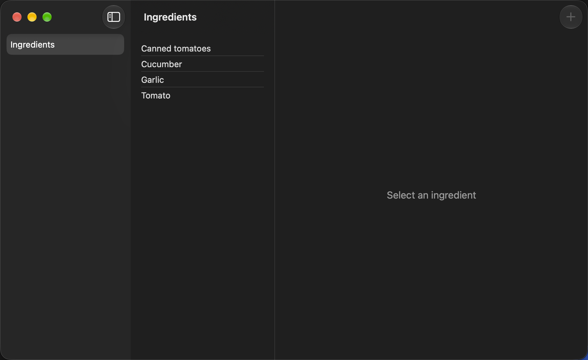
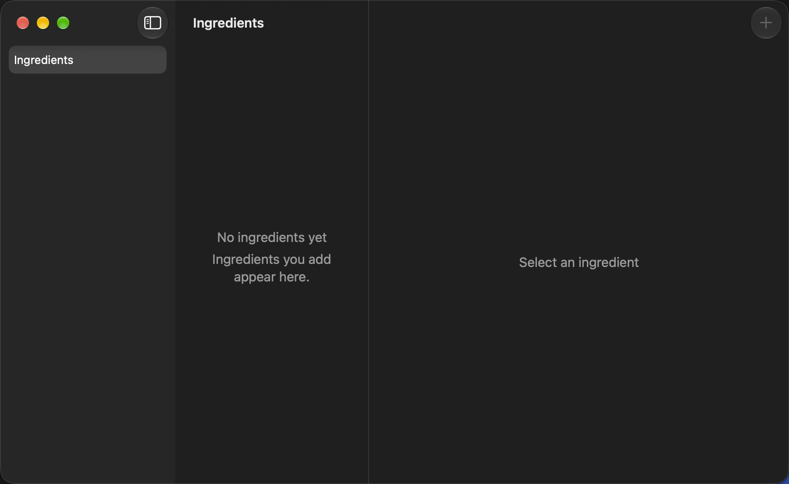

# MAC-01 demo — the Mac window shows the ingredient catalog

Captured on 2026-10-12 with macOS 27.0.1 and Xcode 27.0, on Apple Silicon.
The window uses its default size (960 × 600 points) and the Mac's system
appearance (dark on this Mac). Light mode is covered by the snapshot tests.

`MacDemoCaptureUITests` captured these screenshots from the running app with
the real Rust core. Each launch uses a new, isolated database in the app's
temporary folder (E-18). Rust saved the listed names before the app started
(`KREATYNA_TEST_SEED`, E-17).

To capture again:

```sh
.agents/skills/document-apple-delivery/scripts/capture-demo.sh mac \
  KreatynaMacUITests/MacDemoCaptureUITests docs/epics/mac-shell/tasks/MAC-01-demo
```

## 1. Catalog with rows

*Start:* a database seeded with Garlic, Tomato, Canned tomatoes, and Cucumber.
*Action:* launch the app.
*Result:* three columns. The sidebar has **Ingredients**. The list shows the
names in Rust's order. The detail pane says "Select an ingredient". **＋** is
disabled (MAC-05).



## 2. Empty catalog

*Start:* a new, empty database.
*Action:* launch the app.
*Result:* the list says "No ingredients yet" and "Ingredients you add appear
here."



## Not captured from the running app

- **Startup failure and Retry.** The app has no way to force a database
  failure. The snapshots `startupFailure-appearance.light.png` and
  `.dark.png` show the state, and the Swift Testing test
  `startupFailureRendersAndRetryIsForwarded` checks the real Retry path.
- **List load failure.** Rust's SQLite store does not fail on demand. The
  view code is the same pattern as iOS.

## Checks

See **Validation** in [MAC-01.md](../MAC-01.md).
