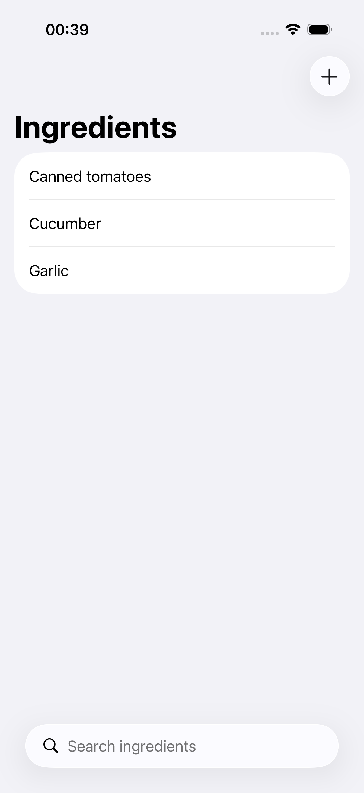
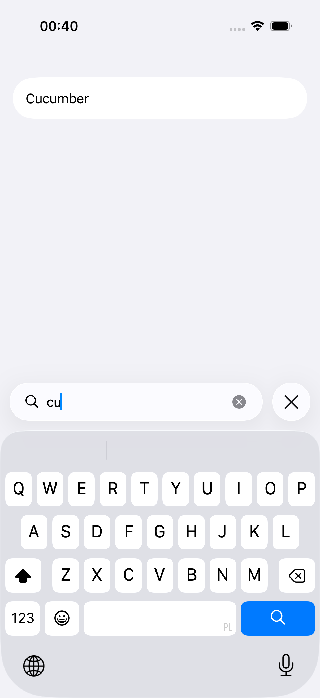
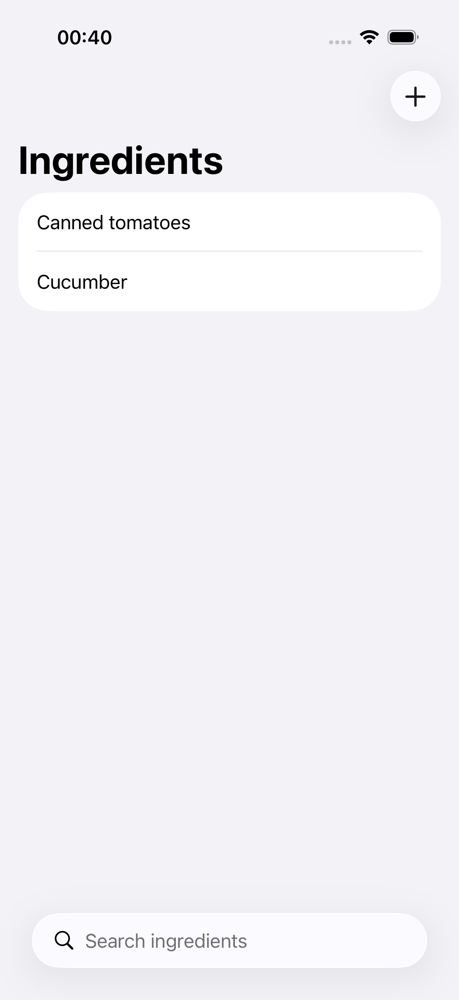

# MAC-03 demo — Counter leaves the app

Captured on 2026-10-12 with `DemoCaptureUITests` (the real Rust core and a
fresh, isolated database). Device: iPhone 17 Pro simulator, iOS 26.3, light
mode. The test captured all 15 ingredient-catalog demo screens. This page shows
the three that this slice changes. The others match
[the ingredient-catalog demo](../../../ingredient-catalog/demo.md) without the
tab bar.

| Starting condition | Action | Visible result |
|---|---|---|
| The catalog has Canned tomatoes, Cucumber and Garlic. | Launch the app. | The catalog opens directly. There is no tab bar. The search field is at the bottom (iOS 26 places it there when a screen has no tab bar). |
| Same catalog. | Type "cu" in the search field. | Only Cucumber is in the list. |
| Garlic was deleted. | Quit and relaunch the app. | Canned tomatoes and Cucumber are still there. |

