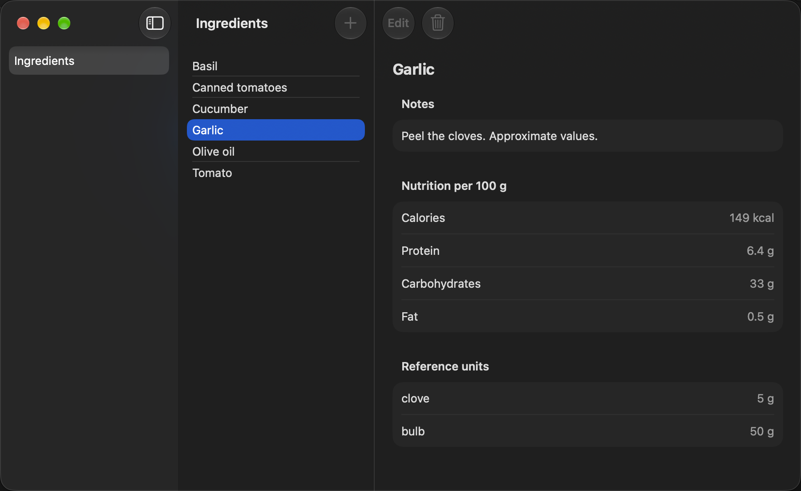
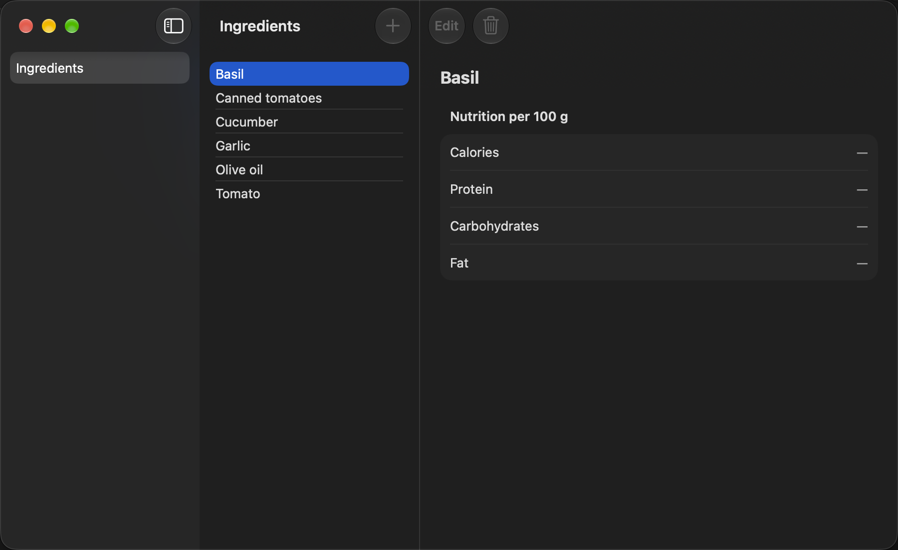

# MAC-04 demo — select an ingredient to see its details

Captured on 2026-10-13 with macOS 27.0.1 and Xcode 27.0, on Apple Silicon.
The window uses its default size (960 × 600 points) and the Mac's system
appearance (dark on this Mac). Light mode is covered by the snapshot tests
`detailWithFullData` and `detailWithNameOnly`.

`MacDemoCaptureUITests.testCaptureMAC04Demo` captured these screenshots from
the running app with the real Rust core. The launch uses a new, isolated
database (E-18). Rust saved `apple/Kreatyna/Fixtures/demo-ingredients.json`
into it before the app started (E-17). Every click goes through the normal
event path: Swift sends `select`, and Rust's split catalog opens the detail
(E-19).

To capture again:

```sh
.agents/skills/document-apple-delivery/scripts/capture-demo.sh mac \
  KreatynaMacUITests/MacDemoCaptureUITests/testCaptureMAC04Demo \
  docs/epics/mac-shell/tasks/MAC-04-demo
```

## 1. Garlic: full data

*Start:* the seeded catalog with nothing selected ("Select an ingredient").
*Action:* click **Garlic**.
*Result:* the row is highlighted from Rust's selection. The pane shows the
title, Notes, "Nutrition per 100 g" (149 kcal, 6.4 g, 33 g, 0.5 g), and the
reference units clove 5 g and bulb 50 g. **Edit** and **Delete** are
disabled (MAC-06, MAC-07).



## 2. Basil: a name only

*Start:* Garlic is selected.
*Action:* click **Basil**.
*Result:* Basil's detail replaces Garlic's. Basil has no notes and no units,
so those sections are absent, and each nutrition value shows "—".



## Not captured as screenshots

- **Launch with nothing selected.** Same as the MAC-01 demo: "Select an
  ingredient".
- **↓ and ⌘-click.** The UI test `testSelectingRowsShowsTheirDetail` presses
  ↓ (Basil → Garlic) and ⌘-clicks Garlic (back to "Select an ingredient").
- **A delete that is running or confirmed.** **Delete** is disabled until
  MAC-07. Rust tests cover the rules.

## Checks

See **Validation** in [MAC-04.md](../MAC-04.md).
