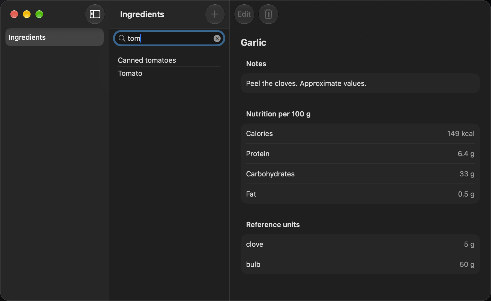
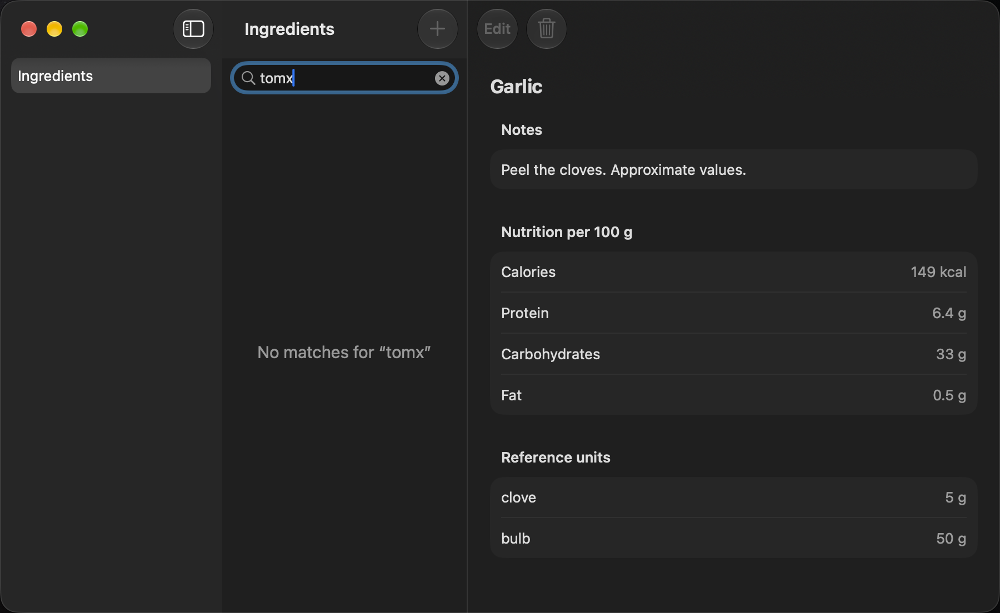

# MAC-08 demo — search the catalog from the toolbar

Captured on 2026-10-13 with macOS 27.0.1 and Xcode 27.0, on Apple Silicon.
The window uses its default size (960 × 600 points) and the Mac's system
appearance (dark on this Mac). Light mode is covered by the snapshot tests
`filteredCatalog` and `noMatches`.

`MacDemoCaptureUITests.testCaptureMAC08Demo` captured these screenshots from
the running app with the real Rust core and the demo fixture
(`apple/Kreatyna/Fixtures/demo-ingredients.json`, E-17). Each keystroke
goes to Rust as `.search(query:)`; Rust filters the rows. Swift does no
filtering.

To capture again:

```sh
.agents/skills/document-apple-delivery/scripts/capture-demo.sh mac \
  KreatynaMacUITests/MacDemoCaptureUITests/testCaptureMAC08Demo \
  docs/epics/mac-shell/tasks/MAC-08-demo
```

## 1. Search "tom" with Garlic open

*Start:* Garlic is selected and its detail is open.
*Action:* click the search field above the list and type "tom".
*Result:* the list shows Canned tomatoes and Tomato. Garlic's row is
hidden, and Garlic's detail stays open (MAC-08/Q1).



## 2. No matches

*Start:* the search is "tom".
*Action:* type "x".
*Result:* the list says "No matches for “tomx”". The detail stays.



## Not captured as screenshots

- **Esc** clears the field, and every row comes back. The UI test
  `testSearchNarrowsTheList` checks it.
- **⌘F** does not focus the field yet. You click it. See Validation in
  [MAC-08.md](../MAC-08.md).

## Checks

See **Validation** in [MAC-08.md](../MAC-08.md).
